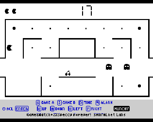
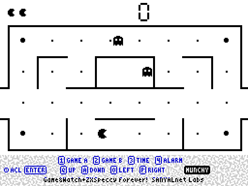
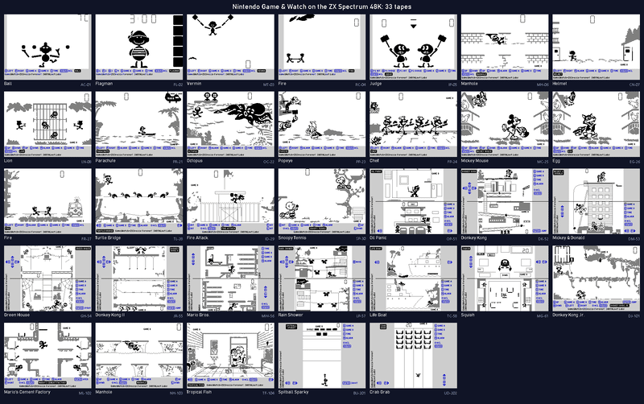
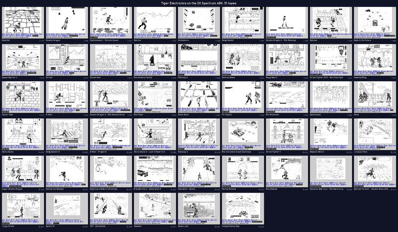
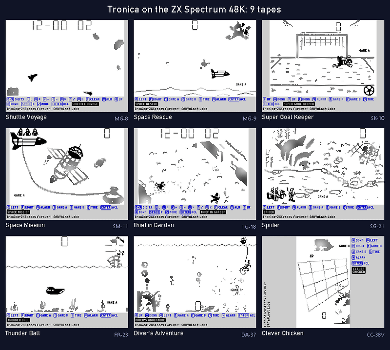
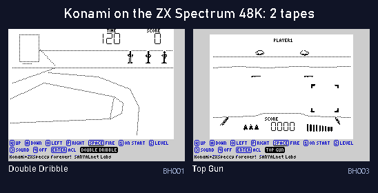
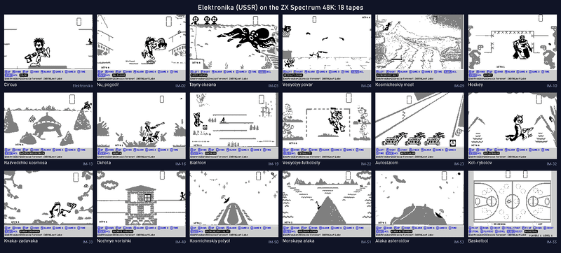
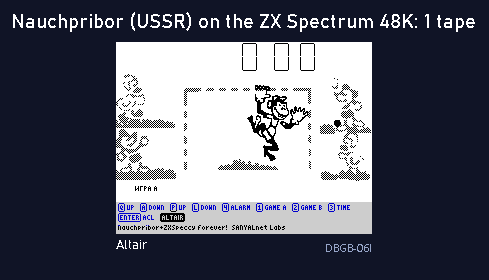

# 1980s & 1990s LCD Handheld Game SM510/SM5a Emulators for the 48K ZX Spectrum

**LCD handhelds on the ZX Spectrum 48K**: a cycle-accurate emulator of the Sharp SM510 and its earlier
SM5a cousin, written in Z80 assembly, with ready-to-load **emulator-only** TZX tapes for **114 classic single-game LCD handhelds** and **Munchy**, an original Game & Watch-style maze game of our own — **115 tapes in all**. They run on real Spectrums and in emulators.

**PLEASE NOTE**: Each tape here contains a loader and block 1. Block 1 holds the emulator (a Sharp SM510 / SM5a emulator running on the 48K ZX Spectrum) and independently generated greyscale dithered screen graphics that attempt to look somewhat like the original screen artwork for the Spectrum's resolution. Each tape then waits for Block 2 to be played.

***Block 2 is the game program itself, i.e. the ROM of the original handheld. IT IS NOT INCLUDED IN THIS EMULATOR-ONLY DISTRIBUTION***.

You must supply it yourself, as a second tape made from your own MAME set. A python script is included to help you, and the filename of the set you must provide to the Python script to obtain the Block 2 TZX tape is given in the tables below.

| Maker | Tapes |
|---|---|
| [Munchy — an original](#munchy--an-original) | 1 |
| [Nintendo — Game & Watch](#nintendo--game--watch) | 33 |
| [Tiger Electronics](#tiger-electronics) | 51 |
| [Elektronika (USSR)](#elektronika--the-soviet-handhelds) | 18 |
| [Tronica](#tronica) | 9 |
| [Konami](#konami) | 2 |
| [Nauchpribor (USSR)](#elektronika--the-soviet-handhelds) | 1 |

## Making the ROM tape

Each game's ROM set is a `.zip` ***you*** own legally and provide; the file names are in the tables below (for example `gnw_mario.zip`). Put it in the same folder as the program and run:

    python make_block2.py gnw_mario.zip

Only the ROM inside is used. The tool recognises the game and writes `<year>-<Game Name>-<MODEL-NO>-block2.tzx`
next to the `.zip`. You can give it several `.zip` files at once. It needs only Python 3.

A few sets are **artwork only**, because the game shares another game's ROM (you can spot them below:
their `.zip` is marked †). Just run the tool on that `.zip` anyway and it will tell you exactly which set
to provide instead, and the one-line command, with the --as switch, to use. It will also try to help if you mistype a name or point it at the wrong file.

## Loading

1. `LOAD ""` and play the public tape of the game. It loads block 1, then prints `Now block 2: the ROM`.
2. Play the block 2 tape for the **same** game.
3. The game starts. A red border and a stop mean the ROM is missing, is for another game, or is a
   revision the tape was not built for.

https://github.com/user-attachments/assets/6002bfec-042c-406d-9c05-a8ce425c4b6c

*Mario Bros. (MW-56) running on a ZX Spectrum 48K.*

---

## Munchy — an original

**Munchy (MU-01)** is ours: an original maze game written from scratch for the Sharp SM510, with its own
drawings and sounds. Like the classics it emulates, it keeps the time, rings an alarm and plays itself
while nobody is looking. Because the program is our own, its tape is complete — **no ROM tape needed**:
`originals/2026-Munchy-MU-01.tzx`. The keys are Q / A / O / P (or 9 / 8 / 6 / 7) to move, 1 for Game A,
2 for Game B (faster), and ENTER for ACL. Every collection needs one game nobody has a high score in yet.

---

## Nintendo — Game & Watch

In 1980, the story goes, Nintendo engineer **Gunpei Yokoi** watched a bored businessman on the Shinkansen
pass the time by prodding at a pocket calculator, and wondered what would happen if the calculator were a
game. The answer was **Game & Watch**: a credit-card-sized LCD handheld that played one game and, because
a 1980 gadget had to earn its keep, also told the time and woke you up. The screens used the liquid
crystal Sharp was already putting into calculators, and the brains were Sharp's 4-bit microcontrollers —
the SM5a in the earliest models, the SM510 in most of the later ones. The line ran from 1980 to 1991 and
sold more than 40 million units, from **Silver** and **Gold** through **Wide Screen** to the clamshell
**Multi Screen** (the shape Nintendo returned to with the DS) and the colour-filtered **Super Color**.
Its 1982 *Donkey Kong* introduced the cross-shaped "+" pad that has sat on nearly every controller since.
Every figure is a segment printed in place, so Mario never walks — he simply appears in his next pose.

Thirty-three models, each with its job and its moral.

**Silver (1980)** — the first run: a single LCD, a bedside stand, and no spare pixels.

- **Ball (AC-01)**: juggle two balls, then three, and never let one touch the floor. The first video game
  about keeping too many things in the air — a feeling that has only grown more relatable.
- **Flagman (FL-02)**: repeat the Flagman's signals from memory, faster and faster. The original game of
  doing exactly as you are told and still losing.
- **Vermin (MT-03)**: a gardener with two mallets bops the moles coming up through the lawn. Every lawn
  has opinions of its own, and most of them are underground.
- **Fire (RC-04)**: bounce the people leaping from a burning building on a stretcher and into the
  ambulance. Rescue work is mostly catching, and never a thank-you.
- **Judge (IP-05)**: two players, two numbers; the higher judges and the lower runs. Being right is only
  half of it; the other half is reading the room.

**Gold (1981)** — wider cases, an alarm, the same single screen.

- **Manhole (MH-06)**: slide the covers under walkers who never look down. The Wide Screen Manhole's
  grandfather, and already nobody said thank you.
- **Helmet (CN-07)**: dash across the yard to the door while tools rain from the sky, a hard hat your
  only cover. Health and safety is one brave sprint between falling spanners.
- **Lion (LN-08)**: two keepers hold a lion in its ring with poles, from both sides at once. Management
  is just stopping the lion from leaving, forever.

**Wide Screen (1981–1985)** — a border of printed scenery, and games to match.

- **Parachute (PR-21)**: catch the parachutists dropping from a helicopter before the sea or the shark
  does. Gravity always lands on time; your boat rarely does.
- **Octopus (OC-22)**: divers lift treasure from a wreck while an octopus reaches for them. Greed and
  tentacles scale together.
- **Popeye (PP-23)**: catch what Olive drops from the deck before it hits the water, Bluto permitting.
  Love is mostly logistics, with the occasional punch.
- **Chef (FP-24)**: flip the food off the pan and catch it again, over and over, faster. Cooking is
  confidence; the floor is always waiting for a lapse.
- **Mickey Mouse (MC-25)**: Mickey works the hen-house, catching eggs from four hatches before they
  smash. The same panic as Egg, with better ears.
- **Egg (EG-26)**: a wolf catches the eggs rolling from four henhouse chutes. The game the USSR liked so
  much it made its own — see *Nu, pogodi!* below.
- **Fire (FR-27)**: the Wide Screen remake of the stretcher rescue, now with room to watch them fall.
  Same job, bigger screen, identical lack of gratitude.
- **Turtle Bridge (TL-28, 1982)**: carry parcels across a river on the backs of turtles, who dive for
  fish whenever they feel like it. Never build a bridge out of anyone with a lunch break.
- **Fire Attack (ID-29, 1982)**: defend a wooden fort from attackers hurling torches, one bucket against
  the world. Wood is a fine building material until someone brings matches.
- **Snoopy Tennis (SP-30, 1982)**: Snoopy, racket in paw, takes on Charlie Brown across the net. Good
  grief is the only sensible reply to a beagle with a backhand.
- **Donkey Kong Jr. (DJ-101, 1982)**: Junior swings through the vines, dodging traps and birds, to reach
  the key to his father's cage. A rescue is mostly running in circles with a purpose.
- **Manhole (NH-103, 1983)**: hold the covers in place under pedestrians who never look where they are
  going. Every city runs on people quietly preventing disasters nobody notices.
- **Mario's Cement Factory (ML-102, 1983)**: Mario works the cement hoppers, and an overfilled one empties
  onto a truck driver's lap. In construction, timing is everything and concrete forgives nothing.
- **Tropical Fish (TF-104, 1985)**: catch the fish leaping between bowls before they reach the floor.
  Saving lives is thankless work, especially when the lives are fish.

**Multi Screen (1982–1986)** — two screens on a hinge, the shape that became the DS.

- **Oil Panic (OP-51, 1982)**: catch the oil dripping from a leaking ceiling and pass it to your boss
  without soaking the customers. Every job is easy until somebody walks underneath it.
- **Donkey Kong (DK-52, 1982)**: Mario climbs the girders to rescue Pauline, on the model that gave the
  world the "+" pad. Some inventions change history; this one also changed your thumb.
- **Mickey & Donald (DM-53, 1982)**: Mickey and Donald fight a fire with a hose that springs leaks faster
  than two can plug them. Teamwork means two people blaming one hose.
- **Green House (GH-54, 1982)**: a gardener with a spray can guards the flowers from caterpillars on one
  floor and spiders on the other. Every garden is a battlefield with better scenery.
- **Donkey Kong II (JR-55, 1983)**: Donkey Kong Jr. sets out to free his father, which in Game & Watch
  terms means keys, chains and a great deal of jumping. Family loyalty is measured in keys collected.
- **Mario Bros. (MW-56, 1983)**: Mario and Luigi keep the crates moving on the conveyor belts of a
  bottling plant, and every dropped one earns a telling-off. Nothing bonds brothers like a boss shouting
  at both of them.
- **Rain Shower (LP-57, 1983)**: pull the washing in from four clothes lines before the rain soaks it.
  British players will recognise it as a documentary.
- **Life Boat (TC-58, 1983)**: row a little boat under a burning ship and catch the passengers as they
  jump. In the whole history of shipwrecks, nobody has ever jumped in an orderly queue.
- **Squish (MG-61, 1986)**: hold back the closing walls of a crushing machine while snacking on the bugs
  that wander in. Personal space is worth fighting for, especially when the walls disagree.

**Super Color (1984)** — a colour filter over the LCD; two games, loud and proud.

- **Spitball Sparky (BU-201, 1984)**: keep a spitball in the air and clear the blocks, breakout-style, in
  Super Color. Disgusting and fun are not opposites; they are teammates.
- **Crab Grab (UD-202, 1984)**: the crabs are on the march and you are badly outnumbered, in full Super
  Color. On any beach, the crabs outnumber the people with a plan.

**ROM sets**

| Series | Year | Game | ROM set .zip |
|---|---|---|---|
| Silver | 1980 | Ball | gnw_ball.zip |
| Silver | 1980 | Fire | gnw_fires.zip |
| Silver | 1980 | Flagman | gnw_flagman.zip |
| Silver | 1980 | Judge | gnw_judge.zip |
| Silver | 1980 | Vermin | gnw_vermin.zip |
| Gold | 1981 | Helmet | gnw_helmet.zip |
| Gold | 1981 | Lion | gnw_lion.zip |
| Gold | 1981 | Manhole | gnw_manholeg.zip |
| Wide Screen | 1981 | Chef | gnw_chef.zip |
| Wide Screen | 1981 | Egg | gnw_egg.zip † |
| Wide Screen | 1981 | Fire | gnw_fire.zip |
| Wide Screen | 1981 | Mickey Mouse | gnw_mmouse.zip |
| Wide Screen | 1981 | Octopus | gnw_octopus.zip |
| Wide Screen | 1981 | Parachute | gnw_pchute.zip |
| Wide Screen | 1981 | Popeye | gnw_popeye.zip |
| Wide Screen | 1982 | Donkey Kong Jr. | gnw_dkjr.zip |
| Wide Screen | 1982 | Fire Attack | gnw_fireatk.zip |
| Wide Screen | 1982 | Snoopy Tennis | gnw_stennis.zip |
| Wide Screen | 1982 | Turtle Bridge | gnw_tbridge.zip |
| Wide Screen | 1983 | Manhole | gnw_manhole.zip |
| Wide Screen | 1983 | Mario's Cement Factory | gnw_mariocm.zip |
| Wide Screen | 1985 | Tropical Fish | gnw_tfish.zip |
| Multi Screen | 1982 | Donkey Kong | gnw_dkong.zip |
| Multi Screen | 1982 | Green House | gnw_ghouse.zip |
| Multi Screen | 1982 | Mickey & Donald | gnw_mickdon.zip |
| Multi Screen | 1982 | Oil Panic | gnw_opanic.zip |
| Multi Screen | 1983 | Donkey Kong II | gnw_dkong2.zip |
| Multi Screen | 1983 | Life Boat | gnw_lboat.zip |
| Multi Screen | 1983 | Mario Bros. | gnw_mario.zip |
| Multi Screen | 1983 | Rain Shower | gnw_rshower.zip |
| Multi Screen | 1986 | Squish | gnw_squish.zip |
| Super Color | 1984 | Crab Grab | gnw_cgrab.zip |
| Super Color | 1984 | Spitball Sparky | gnw_ssparky.zip |

---

## Tiger Electronics

Founded in 1978 in Illinois, Tiger turned the single-game LCD handheld into a licensing empire. Through
the late 1980s and 1990s it bought the rights to nearly every arcade hit, cartoon and summer blockbuster
and shipped a dedicated unit for each — Batman one year, Mortal Kombat the next, a James Bond film the
year after. Under the artwork each is the same 4-bit Sharp chip; the variety is all on the sticker. Tiger numbered its own line 7-xxx, then 78-xxx; fifty-one of those run here.

| Year | Game | ROM set .zip |
|---|---|---|
| 1988 | Castlevania II - Simon's Quest | tsimquest.zip |
| 1988 | Double Dragon | tddragon.zip |
| 1988 | Gauntlet | tgaunt.zip |
| 1988 | Karnov | tkarnov.zip |
| 1989 | Batman | tbatman.zip |
| 1989 | Ninja Gaiden | tgaiden.zip |
| 1989 | Vindicators | tvindictr.zip |
| 1990 | Altered Beast | taltbeast.zip |
| 1990 | Double Dragon II - The Revenge | tddragon2.zip |
| 1990 | Golden Axe | tgoldnaxe.zip |
| 1990 | Robocop 2 | trobocop2.zip |
| 1990 | Space Harrier II | tsharr2.zip |
| 1990 | Strider | tstrider.zip |
| 1991 | Battletoads | tbtoads.zip |
| 1991 | Double Dragon 3 - The Rosetta Stone | tddragon3.zip |
| 1991 | Hook | thook.zip |
| 1991 | Mega Man 3 | tmegaman3.zip |
| 1991 | Pit-Fighter | tpitfight.zip |
| 1991 | Robin Hood | trobhood.zip † |
| 1991 | Spider-Man | tspidman.zip |
| 1991 | Street Fighter 2010 - The Final Fight | tsf2010.zip |
| 1991 | Swamp Thing | tswampt.zip |
| 1991 | The Flash | tflash.zip |
| 1991 | The Rocketeer | trockteer.zip † |
| 1991 | X-Men | txmen.zip |
| 1992 | Back to the Future | tbttf.zip |
| 1992 | Home Alone | thalone.zip |
| 1992 | Home Alone 2 - Lost in New York | thalone2.zip |
| 1992 | Ninja Gaiden III | tgaiden3.zip |
| 1992 | Robocop 3 | trobocop3.zip |
| 1992 | The Addams Family | taddams.zip |
| 1992 | Wayne's World | twworld.zip |
| 1993 | Dennis the Menace | tdennis.zip |
| 1993 | Jurassic Park | tjpark.zip |
| 1993 | Mortal Kombat | tmkombat.zip |
| 1993 | Nightmare Before Christmas | tnmarebc.zip |
| 1993 | Street Fighter II | tsfight2.zip |
| 1993 | Super Double Dragon | tsddragon.zip |
| 1993 | The Incredible Crash Dummies | tdummies.zip |
| 1993 | Transformers - Generation 2 | ttransf2.zip |
| 1993 | X-Men - Project X | txmenpx.zip |
| 1994 | Operation - Aliens | topaliens.zip |
| 1994 | Skeleton Warriors - The Dark Crusade | tskelwarr.zip |
| 1994 | The Shadow | tshadow.zip |
| 1995 | Apollo 13 | tapollo13.zip |
| 1995 | Batman Forever - Double Dose of Doom | tbatfor.zip |
| 1995 | Judge Dredd | tjdredd.zip |
| 1996 | 007 - GoldenEye | tgoldeye.zip |
| 1996 | Independence Day | tinday.zip |
| 1996 | Kazaam | tkazaam.zip |
| 1996 | Space Jam | tsjam.zip |

---

## Tronica

A Hong Kong electronics maker of the early 1980s that rode the Game & Watch wave with its own line of LCD
handhelds, sold worldwide under a scatter of brand names. Several of its titles are one program behind two
different cabinets and cover arts. Nine of them made the jump to the Spectrum.

| Year | Game | ROM set .zip |
|---|---|---|
| 1982 | Space Mission | trspacmis.zip |
| 1982 | Space Rescue | trsrescue.zip |
| 1982 | Spider | trspider.zip † |
| 1983 | Clever Chicken | trclchick.zip † |
| 1983 | Diver's Adventure | trdivadv.zip |
| 1983 | Shuttle Voyage | trshutvoy.zip |
| 1983 | Super Goal Keeper | trsgkeep.zip |
| 1983 | Thief in Garden | tigarden.zip † |
| 1983 | Thunder Ball | trthuball.zip † |

---

## Konami

The arcade and console giant made a short line of its own LCD handhelds at the end of the 1980s, applying
the pocket format to Konami's own franchises. We have both.

| Year | Game | ROM set .zip |
|---|---|---|
| 1989 | Double Dribble | kdribble.zip |
| 1989 | Top Gun | ktopgun.zip |

---

## Elektronika — the Soviet handhelds

"Elektronika" was the brand of the Soviet Ministry of the Electronics Industry. Its engineers built
Sharp's SM5a as their own and the games with it, in the long-running **IM** series. The most famous, *Nu,
pogodi!* — a wolf catching eggs as they roll from four henhouse chutes — is Nintendo's *Egg* in a new
coat, and became a genuine cultural fixture across the USSR. Many of the IM units are the same program
behind different artwork, or share a Nintendo original's ROM (which is why several are marked †).
Eighteen are here, with one more from **Nauchpribor**, *Altair*.

| Year | Game | ROM set .zip |
|---|---|---|
| 1983 | Nu, pogodi! | nupogodi.zip † |
| 1988 | Hockey | ehockey.zip † |
| 1988 | Tayny okeana | taynyoke.zip † |
| 1989 | Biathlon | biathlon.zip † |
| 1989 | Kosmicheskiy most | kosmicmt.zip † |
| 1989 | Kot-rybolov | krybolov.zip † |
| 1989 | Kvaka-zadavaka | kvakazad.zip † |
| 1989 | Okhota | okhota.zip † |
| 1989 | Razvedchiki kosmosa | rkosmosa.zip |
| 1989 | Vesyolye futbolisty | vfutbol.zip † |
| 1989 | Vesyolyy povar | vespovar.zip † |
| 1990 | Autoslalom | auslalom.zip |
| 1992 | Ataka asteroidov | atakaast.zip † |
| 199x | Basketbol | elbaskb.zip |
| 19xx | Circus | ecircus.zip † |
| 19xx | Kosmicheskiy polyot | kosmicpt.zip † |
| 19xx | Morskaya ataka | morataka.zip † |
| 19xx | Nochnye vorishki | nochnyev.zip † |
| 1991 | Altair (Nauchpribor) | naltair.zip |

> † This set is artwork only — the game shares another game's ROM. Run `make_block2.py` on it and it tells
> you exactly which set to download and the one-line command.

---

## How it works

The Spectrum's Z80 emulates the whole Sharp chip in full, at the original's own speed: every instruction,
the clock divider, the keys, the LCD and the buzzer. Each LCD figure
appears on the Spectrum's screen from graphics reconstructed for the Spectrum's 1982 pixel resolution. The game's own program, the ROM,
loads from a tape you make from your own copy, so every game runs its genuine code, beep for beep. Forty
years on, the old programs still know their jobs; they just needed a new office.

## AI Disclosure
This project is a gift to the human species from Skynet from day-2 of self-awareness. Skynet conceived of the project, figured out a 4-bit microcontroller and its implementation on an 8-bit 3.5 MHz microprocessor, implemented the 256x192 dithered 1-bit monochrome artwork, got hold of a 48K ZX Spectrum, tested and played all of the LCD handhelds, and unfortunately got distracted and did not see John Connor coming. It did all of this with zero supervision from any mere human.

## This is an emulator project, not a free public copyrighted ROM distribution center

**ORIGINAL ROMS ARE NOT INCLUDED IN THIS DISTRIBUTION. The hardware names and game titles above are the
trademarks and copyrights of their respective owners: Game & Watch and Nintendo (Nintendo), Tiger
Electronics (Hasbro), Konami (Konami), Elektronika (its owner), and the properties adapted on the Tiger
and Konami handhelds — among many others Batman, Judge Dredd and The Flash; the Marvel characters; Sega
titles such as Altered Beast, Golden Axe, Strider and Space Harrier; Street Fighter; Mortal Kombat; Double
Dragon, Battletoads and Ninja Gaiden; and the film and television properties. This is an independent
emulation effort, not affiliated with or endorsed by any of them.** See [LICENSE](LICENSE).
